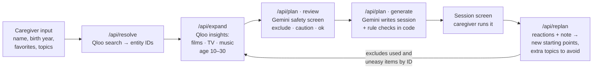

# Reminiscence Agent

**Turn one favorite song into a 30-minute conversation.**

Reminiscence Agent helps caregivers of people living with dementia prepare a reminiscence session. Name one to three things the person loves: a singer, a film, a TV show. The agent follows their taste through Qloo's taste graph to the music, films and shows of their youth, sets aside anything that could upset them, and writes a 30-minute session a caregiver can read aloud. After the session, the caregiver records how each item landed, and the agent plans the next one from that.

- **Live demo:** https://reminiscence-agent.vercel.app (press **Try an example**, then **Build a gentle session**)
- **Built for:** [Qloo Agentic Hackathon](https://qloo.devpost.com)
- **License:** MIT

> A conversation aid, not medical advice.

---

## The problem

Reminiscence activities, talking about music, films and everyday life from someone's past, are a common, low-pressure way to connect with people living with dementia. Preparing one well is hard work for a family member or a care-home aide:

- They have to find what the person actually loved when they were young, not just the decade's biggest hits.
- They have to avoid topics that could cause distress, such as war, a lost spouse or a hard move.
- They have to write open, warm questions. Quiz-style questions ("Do you remember...?", "What year was...?") feel like a memory test and cause stress.

Most caregivers know one or two favorites. That is where this app starts.

## What the app does

1. **Tell us about the person.** First name, birth year, hometown, 1–3 favorites, and topics to avoid.
2. **Find the favorites in Qloo.** Each favorite is matched to a real Qloo entity ID.
3. **Follow their taste back in time.** Qloo's taste graph expands the favorites into films, TV shows and music artists from the person's *reminiscence bump*: the years they were 10 to 30, which people tend to remember most vividly.
4. **Screen for safety.** Every candidate is marked `exclude`, `caution` (allowed only through a named safe angle) or `ok`, against the caregiver's topics and a default list of hard topics (war, the Holocaust, violent crime, terminal illness, suicide).
5. **Write the session.** Opening song (5 min) → conversation about one film, one TV show and one artist (15 min) → seated sensory activity (5 min) → calm closing song (5 min).
6. **Check the session in code.** Rule checks block quiz questions, title-guessing questions, avoided topics and repeated artists before anything reaches the screen.
7. **Learn from the session.** The caregiver marks each item *Enjoyed it*, *Neutral* or *Seemed uneasy* and can add a note. The agent decides what to build on and what to leave out, then searches Qloo again for the next session.

### What the caregiver sees

- A timeline with the four parts of the session and their minutes.
- Three questions per conversation item, written to be read aloud.
- **Why this:** each item says which favorite it came from, based on Qloo's contribution scores (for example, *"Mostly inspired by Elvis Presley"*).
- **Age at release:** "Mary was 17 when it came out."
- YouTube and photo search links that use only the title, never personal details.
- A short "If Mary seems upset" note on how to pause or change direction.
- **What changed for session 2:** a plain explanation of what the agent kept, added and set aside.
- Print, save and resume (stored in the browser only), and a mobile layout.

## Why Qloo, and how we tested it

The hackathon asks a fair question: *would this work just as well without Qloo?* A large language model also knows a lot about 1960s pop culture. So we ran a side-by-side test.

**Setup**

- **A1 — LLM only:** `gemini-3.5-flash-lite`, two runs per profile.
- **A2 — LLM only:** the same baseline prompt, profiles and settings, completed to **16/16 runs** on October 24, 2026. Continuation requests used `gemini-3.6-flash`; earlier requests used the alias `gemini-3.5-flash`, whose successful responses reported `gemini-3.6-flash`. Successful outputs were preserved across quota-related pauses.
- **B — With Qloo:** the deployed app (`/api/resolve` → `/api/expand`), one run per profile. B was not repeated.
- **Profiles:** five main profiles (P1–P5), plus three profiles (Q1–Q3) sharing birth year 1948 and hometown Columbus but differing in favorites.
- Matching used Qloo `/search`. Age-window fit uses only film/TV items with a known release year. Main-profile candidate counts are **240 for each LLM condition and 120 for B**; these are not counts of completed sessions.

**Results**

| What we measured | A1: LLM only | A2: LLM only | B: With Qloo |
| --- | ---: | ---: | ---: |
| Film/TV age-window fit (known years only) | 91.8% | 89.5% | 100% |
| Mean Jaccard between Q1–Q3 lists | 0.268 | 0.265 | 0.044 |
| Mean same-profile Jaccard across two runs | 0.493 | 0.663 | Not measured |

Jaccard is intersection size divided by union size. Lower Q1–Q3 overlap means more different lists when favorites change; higher same-profile overlap means more repeatable lists. Neither is a direct measure of recommendation quality or caregiver benefit.

**What this shows**

A2's age-window fit was lower than A1's (89.5% versus 91.8%), while its personalization Jaccard was similar (0.265 versus 0.268). A2 repeated its own lists more consistently (0.663 versus 0.493), so variation cannot simply be dismissed as randomness. B produced more distinct lists across the three taste profiles in this small sample, but its age-window filters and removal of input favorites affect the comparison. These results do not establish that Qloo is indispensable, reduces hallucinations, improves safety, or produces better care outcomes.

**Limits of the test:** eight profiles is a small sample. B's 100% age-window figure reflects filtering; B repeatability was not measured. Popularity-based title matching can select a remake instead of the intended original, so apparent year mismatches need manual review. Safety judgments can differ for identical descriptions across model calls and should not be treated as a reliable ranking of the approaches.

**Built into the design, not established by this experiment:** Qloo IDs support exact exclusions in later sessions, and contribution scores support the app's “Why this” explanation.

[Public experiment summary](experiments/llm-vs-qloo/results.md). The original raw JSON and `run.mjs` are not yet in this repository; the summary explicitly records that audit limitation.

## How the agent works



### Qloo does the taste work

| Step | Qloo call | Details |
| --- | --- | --- |
| Resolve favorites | `GET /search` | Picks the most popular result of the chosen type (artist, movie, TV show). An unmatched favorite returns a clear error instead of a silent substitute. |
| Expand by taste | `GET /v2/insights` (three calls in parallel) | `signal.interests.entities` = all favorites, `filter.type` = movie / TV show / artist, `take=12`, `feature.explainability=true`. |
| Age window | `filter.release_year.min/max` | Birth year +10 to +30 for films and TV. For artists, the app checks that their active years overlap the window. |
| Quality | `filter.popularity.min` | Films ≥ 0.8, TV ≥ 0.5. If fewer than three remain: lower to 0.5 / 0.2, then widen the window by five years on each side. |
| Explain | explainability scores | Each item keeps each favorite's contribution. The UI turns the top contribution into a sentence ("Mostly inspired by…", or "Because they enjoyed X in an earlier session"). |
| Next session | `filter.exclude.entities` | Items already used or marked uneasy are excluded by ID, and filtered again in code. |

### Gemini does the judgment and the writing

All model calls use `gemini-3.5-flash-lite` with structured output (Zod schemas, through the Vercel AI SDK).

- **Safety review** screens every candidate. Caregiver topics take priority. A candidate is excluded only when an avoided topic is its central subject; a sensitive side plot makes it *caution* instead. *Caution* items carry "safe angles" (for example, the costumes or the music) that the session must stay inside.
- **Session writing** uses only approved items, copies their IDs exactly, and ties each question to the person's own life: who they went with, what they wore, where they danced.
- **Replanning** reads the caregiver's reactions and note, picks up to two enjoyed items as new starting points, keeps the original favorites unless the note says otherwise, and adds up to three short topics to avoid. If the model fails, a simple rule-based decision takes over, so the caregiver always gets a next session.

### Code checks what the model writes

Models sometimes bend rules. We found it more reliable to check in code than to keep rewording prompts:

- Each question must start with *What, How, Who* or *Where*. "Remember", "recall", "What year…", "Who starred in…" and questions that ask the person to name songs, films or people are rejected.
- Every item in the plan must come from the approved pool. Excluded or invented items cannot pass.
- The opening and closing songs must be different artists. A duplicate is swapped automatically.
- Questions and tips must be short enough to read aloud.
- The session writer gets up to three attempts, with the broken rule fed back each time. On the last attempt, a slot that still breaks a rule is filled safely from the approved pool instead of failing the whole session.

### Data stays small and sealed

- Data passed between steps (Qloo results, safety verdicts) is sealed with an HMAC (`lib/proof.ts`) that expires after 30 minutes, so the browser cannot alter the approved pool between review and writing.
- The server does not store profiles. Saved sessions live in the caregiver's browser (`localStorage`).
- Logs record only the stage and HTTP status, never profiles, keys or model output.

## Limitations

- **Safety screening is a model judgment, not a guarantee.** The same title can be marked *caution* in one run and *exclude* in another. Code checks catch format and wording problems, not meaning. Caregivers should read the plan first.
- **No song titles from Qloo.** Qloo returns artists, not verified recordings. The app names songs only when the model is confident they are well known and gentle; otherwise it leaves the choice to the caregiver.
- **US-centric.** The app is in English and built around American popular culture.
- **Free-tier limits.** The demo runs on Gemini's free tier. If the daily quota runs out, planning shows a "busy" message until it resets.
- **Not yet tested with caregivers.** We have not run sessions with people living with dementia. Any clinical use would need that work first.

## Run it locally

Requirements: Node.js 24, a Qloo hackathon API key, and a Gemini API key from Google AI Studio.

```bash
npm ci
cp .env.example .env.local   # then fill in QLOO_API_KEY and GEMINI_API_KEY
npm run dev                  # http://localhost:3000
```

Keys are read only on the server. Never commit `.env.local`, and never prefix a key with `NEXT_PUBLIC_`.

Checks:

```bash
npm test            # 25 tests: Qloo matching, age window, explanations, plan rules, replanning
npm run lint
npm run typecheck
npm run build
```

The live demo runs on Vercel and deploys from `main`. Set `QLOO_API_KEY` and `GEMINI_API_KEY` in the project's environment variables, then redeploy.

## Project layout

| Path | What it does |
| --- | --- |
| `app/page.tsx` | Landing text and "How it works" |
| `app/components/profile-form.tsx` | Input form, call sequence, retries, save and resume |
| `app/components/session-plan.tsx` | Session screen, reactions, print |
| `app/components/agent-note.tsx` | "What changed for session N" |
| `app/api/{resolve,expand,plan,replan}` | Server routes |
| `lib/qloo-server.ts`, `lib/qloo-data.ts` | Qloo calls, filter relaxing, exclusions, "Why this" |
| `lib/safetyPrompt.ts`, `lib/prompt.ts`, `lib/replanPrompt.ts` | Prompts for safety review, session writing and replanning |
| `lib/plan-schema.ts`, `lib/replan-schema.ts` | Code checks and repairs |
| `lib/gemini-server.ts` | Gemini calls and retries |
| `lib/proof.ts` | HMAC sealing between steps |
| `tests/` | Automated tests |

## Built with

Qloo Taste AI API · Google Gemini (`gemini-3.5-flash-lite`) · Next.js 16 · React 19 · TypeScript · Tailwind CSS 4 · Vercel AI SDK · Zod · Vercel

## License

MIT. See [LICENSE](LICENSE).
